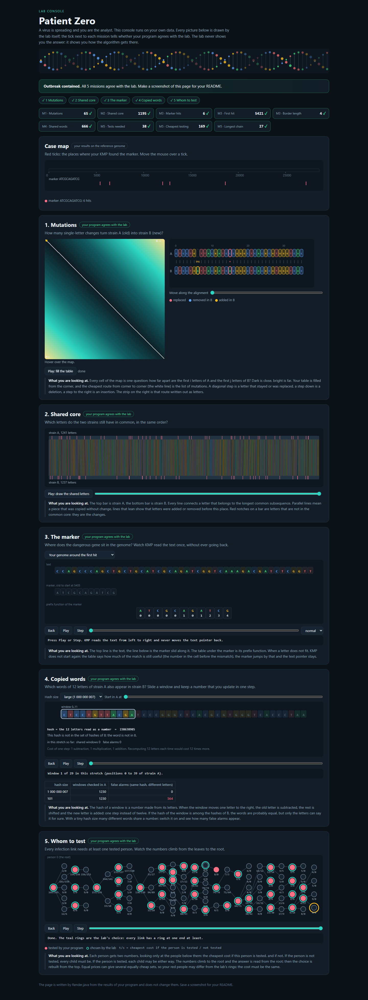

# Assignment 4. Patient Zero

Student ID **254488**

See [START_HERE.md](START_HERE.md) for setup and [Assignment 4](docs/Assignment4.pdf) for the specification.

## Program output

Results from `java -cp out Main` on the generated variant.

    Mutations: 65
    Shared core: 1195
    Marker hits: 6
    First hit: 5421
    Border length: 4
    Shared words: 666
    Tests needed: 38
    Cheapest testing: 169
    Longest chain: 27

My outbreak report (a screenshot of `output/outbreak.html`):

## Questions

Draft explanations to review and rewrite in your own words before submitting.

Mission 1. What does the cell d[i][j] of your table mean, and how is it computed from other cells?

`d[i][j]` is the minimum number of edits needed to turn the first `i` letters of A into the first `j` letters of B. Take the minimum of the cell above plus one for deletion, the cell to the left plus one for insertion, and the diagonal plus zero or one depending on whether the last letters agree. An empty prefix needs one insertion or deletion per letter in the other prefix.

Mission 2. How is the longest common subsequence different from the longest common substring? My Shared core is bigger than the number of letters that are the same at the same place: why?

A common subsequence can skip letters in either strain while keeping the letters in order. A common substring has to be contiguous in both strains. An insertion can shift every later letter by one position, but the LCS can still pair those letters at their new positions.

Mission 3. What does the prefix function tell you, and why does the pointer in the text never go back in KMP? What is the Border length of my marker and what does it mean?

For each prefix ending at index `i`, `pi[i]` gives the length of its longest proper prefix that is also its suffix. On a mismatch KMP shortens the current match using `pi` and retries the same text letter, since the suffix of the text already read still matches the shorter prefix. The marker `ATCGCAGATCG` has border length 4 because its longest proper border is `ATCG`.

Mission 4. Why must you compare the letters after the hashes are equal? What happens to the cost of Rabin-Karp if many windows have the same hash?

Two different words can have the same hash, so the program checks their letters before counting a match. Rolling the hash still takes constant time per shift, but a crowded hash bucket can make each window of A check many candidate windows of B, at up to `k` letter comparisons per candidate.

Mission 5. What are the two states of a person in your DP, and how do you get the answer for a person from its children? Why does a greedy "test the person with most links first" not always give the cheapest answer?

For each subtree, I compute its minimum cost with the root tested and its minimum cost with the root untested. If the root is tested, I add its price and the cheaper state for each child. If it is untested, every child must be tested to cover the link to the root. In a star with a center that costs 10 and three leaves that cost 1 each, testing the three leaves costs 3 even though the center has the most links.

## AI use

OpenAI Codex generated the first implementation of the mission algorithms and drafted the README explanations using the provided starter project and course hints. It also generated the variant data with the supplied tool, ran the checks and benchmark, and captured the lab screenshot.

## Timing (Mission 7)

Milliseconds, average of 3 runs, from `java -cp out Bench`.

| test | size | time |
|---|---|---|
| naive search | 20 000 / 40 000 / 80 000 | |
| KMP | 20 000 / 40 000 / 80 000 | |
| edit distance | 500 / 1000 / 2000 / 4000 | |

What do the numbers say about how the time grows? When you double the size, by how much does each time grow? Two or three sentences.

## Complexity

n is the length of the text (or of a strain), m the length of the pattern, k the length of the window, v the number of people. Fill in every algorithm you wrote.

| algorithm | time | space | assumptions |
|---|---|---|---|
| Edit distance | | | |
| LCS | | | |
| Prefix function and KMP | | | |
| Rabin-Karp (shared words) | | | |
| Tree DP | | | |

## Before you submit

- The four files in `data` and the screenshot `output/outbreak.png` are in the repository.
- `java tools/Check.java` shows all examples right.
- This README is filled in, the program output and the section AI use included.
- The work is pushed to main (at least one commit per mission) and the repository is public.
- The link is attached in Moodle.
